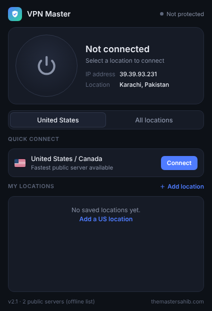
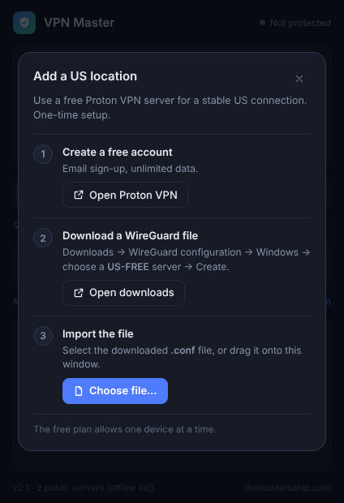
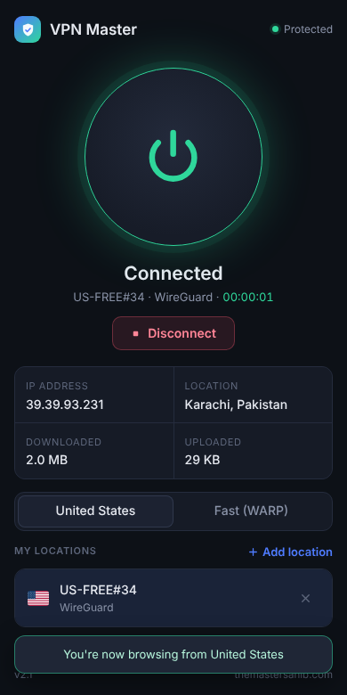

<p align="center"></p>

<h1 align="center">VPN Master</h1>
<p align="center">Free, lightweight VPN for Windows and Android, by <a href="https://themastersahib.com">The Master Sahib</a>.</p>

<p align="center">
  
  
  
</p>

## Download

| Platform | Latest version |
|---|---|
| **Windows 10/11** | [⬇ VPNMaster.exe](https://github.com/mohammadfaisalpirzada/VPN_Master/releases/latest/download/VPNMaster.exe) (portable, no installer) |
| **Android 7.0+** | [⬇ VPNMaster.apk](https://github.com/mohammadfaisalpirzada/VPN_Master/releases/latest/download/VPNMaster.apk) |

These links always point to the newest release. Every release is also listed on [Releases](https://github.com/mohammadfaisalpirzada/VPN_Master/releases) and on [The Master Store](https://themastersahib.com/the-master-store).

## Features

| | Windows (`VPNMaster.exe`, ~9 MB) | Android (`VPNMaster.apk`, ~4.5 MB) |
|---|---|---|
| **United States** | Quick connect to public US/Canada servers, or your own WireGuard locations | Your own WireGuard locations |
| **Worldwide** | ~100 public [VPN Gate](https://www.vpngate.net) servers with country filter, ping and speed | Cloudflare WARP (fast, nearest location) |
| **Engine** | Embedded WireGuard (wireguard-go + wintun), plus the VPN client built into Windows (SSTP, then L2TP/IPsec) | Official WireGuard tunnel library |
| **Account** | None needed. A free Proton VPN account is optional, for stable US locations | Same |
| **Install** | Single portable exe, no installer | Standard APK, Android 7.0+ |

Other details:
- Works when vpngate.net is blocked. The app resolves the site through DNS-over-HTTPS, and falls back to the last saved server list or the one built into the app.
- The window adapts to small screens, and closing it disconnects the VPN.
- There's a dedicated **Disconnect** button, a connection timer, and live IP/location.

## Adding a US location (free, one time)
1. Create a free account at [account.protonvpn.com](https://account.protonvpn.com/signup).
2. Go to **Downloads → WireGuard configuration**, pick a platform and a **US-FREE** server, then **Create → Download**.
3. In VPN Master: **Add location → Choose file…**, then select it to connect.

The free Proton plan allows one device at a time.

## Releasing a new version
GitHub Actions builds both apps and publishes them. You don't need to build anything locally:
```bash
git tag v2.3.0
git push origin v2.3.0
```
`.github/workflows/release.yml` then builds `VPNMaster.exe` and the signed `VPNMaster.apk`, stamps the version into both apps (shown in the app header), and creates the release with `latest-version.json`. The Master Store reads that file to show the version.

**One-time setup for the signed APK.** Add these repository secrets under *Settings → Secrets and variables → Actions*:
`ANDROID_KEYSTORE_BASE64` (the keystore file, base64), `ANDROID_KEYSTORE_PASSWORD`, `ANDROID_KEY_ALIAS`, `ANDROID_KEY_PASSWORD`.
If they're missing, the workflow still publishes the Windows exe and skips the APK.

## Building locally

### Windows (cross-compiles from Linux, macOS or Windows)
```bash
cd windows
go install github.com/tc-hib/go-winres@latest
go-winres make --arch amd64            # icon, manifest, version info
GOOS=windows GOARCH=amd64 CGO_ENABLED=0 \
  go build -trimpath -ldflags "-s -w -H windowsgui" -o VPNMaster.exe .
```
Requirements: Go 1.25+. At runtime it needs the Microsoft Edge WebView2 Runtime, which is already part of Windows 11 and updated Windows 10.

### Android
```bash
cd android
# optional, for a signed release build:
cat > keystore.properties <<EOF
storeFile=vpnmaster.keystore
storePassword=...
keyAlias=vpnmaster
keyPassword=...
EOF
gradle assembleRelease                  # app/build/outputs/apk/release/
```
Requirements: Android SDK 35, Gradle 8.14, JDK 17+. `keystore.properties` and `*.keystore` are git-ignored.

## Project layout
```
windows/   Go app: WebView2 UI (ui/index.html), VPN Gate + built-in VPN (main.go), WireGuard engine (wg.go)
android/   Kotlin app: WebView UI (assets/index.html), WireGuard backend, WARP registration
docs/      Icon and screenshots
```

## Credits and licenses
- [VPN Gate](https://www.vpngate.net), a public relay research project run with the University of Tsukuba.
- [WireGuard](https://www.wireguard.com), wireguard-go and the WireGuard Android tunnel library. WireGuard is a registered trademark of Jason A. Donenfeld.
- `windows/wintun.dll` is redistributed unmodified under its license (`windows/wintun-LICENSE.txt`).
- Cloudflare WARP and Proton VPN are trademarks of their respective owners. VPN Master is not affiliated with them.

© 2026 Muhammad Faisal Peerzada, The Master Sahib
